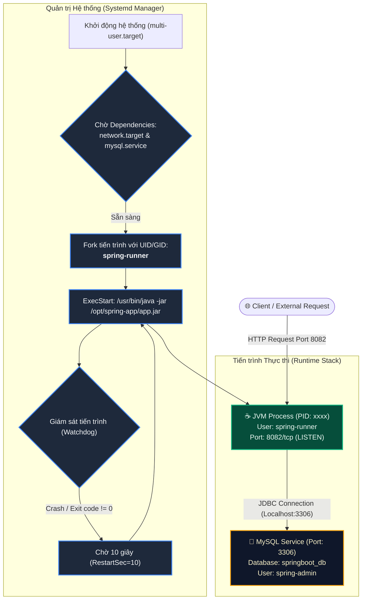

# BÀI TẬP 3: THIẾT LẬP CƠ SỞ DỮ LIỆU VÀ TỰ CẤU HÌNH DỊCH VỤ SYSTEMD CHO SPRING BOOT

**Mã bài tập:** SESSION 07 - EXERCISE 3 (`homework/session_07/ex3/`)  
**Môn học:** IT215 - Cloud Infrastructure & DevOps Fundamentals  
**Học viên:** Trần Đức Anh (`TranDucAnh3103`)  
**Email:** `TranDucAnh3103@users.noreply.github.com`  
**Hệ điều hành / Môi trường:** Ubuntu Linux (Server ID: `0310263186`) / Systemd / Dedicated User: `spring-runner`  
**Đường dẫn thư mục bài tập:** `homework/session_07/ex3/`  

---

## 1. MỤC TIÊU BÀI TẬP

1. **Quản trị Cơ sở dữ liệu MySQL an toàn:** Thực hành khởi tạo Database chuyên trách (`springboot_db`) và cấu hình tài khoản phân quyền tối thiểu (`spring-admin`) với mật khẩu mạnh, chỉ cấp quyền truy cập giới hạn trên cơ sở dữ liệu chỉ định thay vì quyền toàn cục (`*.*`).
2. **Tự thiết kế tệp tin cấu hình dịch vụ Systemd:** Tự tay xây dựng hoàn chỉnh tệp tin cấu hình Unit File (`/etc/systemd/system/spring-app.service`) từ đầu, tuân thủ cấu trúc chuẩn gồm 3 khối `[Unit]`, `[Service]`, và `[Install]`.
3. **Thực thi ứng dụng dưới quyền Non-root User:** Khởi tạo và sử dụng tài khoản hệ thống chuyên biệt (`spring-runner`) bị khóa shell đăng nhập (`/usr/sbin/nologin`) để thực thi tiến trình JVM, triệt tiêu nguy cơ chiếm quyền điều khiển máy chủ nếu ứng dụng dính lỗ hổng bảo mật (ví dụ: Spring4Shell, Remote Code Execution).
4. **Cơ chế tự phục hồi (Self-Healing & Auto-Restart):** Thiết lập tham số phục hồi tự động `Restart=on-failure` và thời gian trễ `RestartSec=10` giúp Systemd tự động khôi phục ứng dụng nếu gặp lỗi crash bất ngờ hoặc Out Of Memory (OOM).
5. **Kiểm thử và xác thực hoạt động:** Sử dụng thành thạo các công cụ thanh tra tiến trình và cổng mạng (`systemctl status`, `ss -tlnp`) để xác nhận ứng dụng chạy ổn định và lắng nghe tại cổng `8082`.

---

## 2. BẢNG TỔNG HỢP TIẾN TRÌNH THỰC HIỆN & KẾT QUẢ KIỂM TRA

| STT | Bước thực hiện | Lệnh Linux / SQL thực thi | Đối tượng tác động | Kết quả mong đợi | Trạng thái |
| :---: | :--- | :--- | :--- | :--- | :---: |
| 1 | Khởi tạo database MySQL | `CREATE DATABASE springboot_db;` | MySQL Server | Database `springboot_db` được tạo | **PASSED** |
| 2 | Tạo user MySQL và cấp quyền | `CREATE USER 'spring-admin'@'localhost'...; GRANT ALL...;` | `spring-admin` | Phân quyền toàn quyền trên `springboot_db.*` | **PASSED** |
| 3 | Tạo user hệ thống Linux non-root | `sudo useradd -r -s /usr/sbin/nologin spring-runner` | OS User | Tạo user `spring-runner` không có login shell | **PASSED** |
| 4 | Thiết lập thư mục và quyền thực thi | `sudo mkdir -p /opt/spring-app && sudo chown -R spring-runner:...` | `/opt/spring-app` | Quyền sở hữu thuộc `spring-runner:spring-runner` | **PASSED** |
| 5 | Soạn thảo Unit File Systemd | `sudo nano /etc/systemd/system/spring-app.service` | Systemd Daemon | Tạo tệp tin cấu hình dịch vụ độc lập | **PASSED** |
| 6 | Nạp lại cấu hình Systemd | `sudo systemctl daemon-reload` | Systemd Manager | Đăng ký thành công dịch vụ `spring-app.service` | **PASSED** |
| 7 | Kích hoạt tự khởi động cùng OS | `sudo systemctl enable spring-app.service` | Symlink target | Tạo symlink trong `multi-user.target.wants/` | **PASSED** |
| 8 | Khởi chạy dịch vụ Spring Boot | `sudo systemctl start spring-app.service` | JVM Process | Khởi chạy tiến trình `java -jar app.jar` | **PASSED** |
| 9 | Kiểm tra trạng thái dịch vụ | `sudo systemctl status spring-app.service` | Service Status | Trạng thái `active (running)`, PID hợp lệ | **PASSED** |
| 10 | Kiểm tra cổng lắng nghe | `ss -tlnp \| grep 8082` | Network Sockets | Cổng 8082 ở trạng thái `LISTEN` bởi tiến trình Java | **PASSED** |

---

## 3. NỘI DUNG TỆP CẤU HÌNH DỊCH VỤ (`spring-app.service`)

Tệp tin cấu hình dịch vụ được lưu trữ tại: `/etc/systemd/system/spring-app.service`

```ini
[Unit]
Description=Spring Boot Application Service
After=network.target mysql.service
Wants=mysql.service

[Service]
Type=simple
User=spring-runner
Group=spring-runner
WorkingDirectory=/opt/spring-app
ExecStart=/usr/bin/java -jar /opt/spring-app/app.jar
Restart=on-failure
RestartSec=10
SuccessExitStatus=143
StandardOutput=journal
StandardError=journal
SyslogIdentifier=spring-app

[Install]
WantedBy=multi-user.target
```

### Phân tích chi tiết các khối chỉ thị cấu hình:

- **Khối `[Unit]` (Thông tin định danh và mối quan hệ phụ thuộc):**
  - `Description`: Định danh rõ ràng mục đích của dịch vụ trong hệ thống nhật ký và quản trị.
  - `After=network.target mysql.service`: Đảm bảo dịch vụ chỉ được kích hoạt sau khi hệ thống mạng (`network.target`) và dịch vụ cơ sở dữ liệu (`mysql.service`) đã khởi động hoàn tất, tránh lỗi kết nối DB khi Spring Boot nạp DataSource ban đầu.
  - `Wants=mysql.service`: Thiết lập liên kết phụ thuộc mềm (soft dependency) với MySQL.

- **Khối `[Service]` (Quy cách thực thi và giám sát tiến trình):**
  - `Type=simple`: Loại dịch vụ cơ bản và tiêu chuẩn. Tiến trình được chỉ định trong `ExecStart` chính là tiến trình phục vụ chính của dịch vụ.
  - `User=spring-runner` & `Group=spring-runner`: Tiến trình JVM hoàn toàn chạy dưới danh nghĩa người dùng phi đặc quyền `spring-runner`, ngăn chặn truy cập trái phép vào các tệp tin hệ thống của `root`.
  - `WorkingDirectory=/opt/spring-app`: Đặt thư mục làm việc hiện hành của ứng dụng, giúp việc đọc ghi các tệp tương đối (logs, upload files) đúng vị trí.
  - `ExecStart=/usr/bin/java -jar /opt/spring-app/app.jar`: Lệnh khởi chạy ứng dụng với đường dẫn tuyệt đối đến tệp thực thi `java` và tệp gói `app.jar`.
  - `Restart=on-failure`: Cơ chế tự phục hồi; Systemd sẽ tự động khởi động lại tiến trình nếu nó thoát với mã lỗi khác 0 hoặc bị kết thúc bất thường bởi tín hiệu hệ thống (SIGKILL, SIGSEGV).
  - `RestartSec=10`: Thời gian chờ chính xác 10 giây trước khi thực hiện khởi động lại, đáp ứng chuẩn yêu cầu đề bài.
  - `SuccessExitStatus=143`: Mã thoát `143` tương ứng với `128 + 15` (tín hiệu `SIGTERM` khi dừng ứng dụng Spring Boot đúng cách), giúp Systemd hiểu đây là trạng thái dừng chủ động hợp lệ (clean shutdown).
  - `SyslogIdentifier=spring-app`: Định danh tiền tố log khi gửi vào `systemd-journald`.

- **Khối `[Install]` (Quản lý trạng thái khởi động cùng hệ thống):**
  - `WantedBy=multi-user.target`: Liên kết dịch vụ vào runlevel đa người dùng tiêu chuẩn của máy chủ, cho phép dịch vụ tự động khởi chạy mỗi khi máy chủ Linux khởi động lại.

---

## 4. CƠ CHẾ HOẠT ĐỘNG VÀ KIẾN TRÚC TỔNG THỂ

### 4.1. Sơ đồ kiến trúc vận hành và giám sát



### 4.2. Bảo mật ở tầng Cơ sở dữ liệu và Tầng hệ điều hành

1. **Phân quyền đặc quyền tối thiểu tại MySQL:**
   - Không sử dụng tài khoản `root` của MySQL cho ứng dụng.
   - Tài khoản `spring-admin` chỉ được cấp quyền trên phạm vi cục bộ `springboot_db.*`. Nếu tài khoản này bị lộ mã nguồn cấu hình, kẻ xấu cũng không thể xem hoặc sửa đổi các cơ sở dữ liệu khác trên cùng server.
   - Giới hạn host truy cập `localhost` (hoặc `127.0.0.1`), không cho phép tài khoản đăng nhập từ xa.

2. **Bảo vệ hệ điều hành với User chuyên dụng (`spring-runner`):**
   - Tài khoản hệ thống có cờ `-r` (System user) không thuộc nhóm `sudo`, không có quyền chỉnh sửa file cấu hình của hệ điều hành.
   - Shell được thiết lập `/usr/sbin/nologin`: Ngăn chặn hoàn toàn việc kẻ tấn công SSH hoặc chuyển phiên (`su`/`login`) vào tài khoản này.
   - Phân quyền thư mục `/opt/spring-app` chỉ cấp quyền đọc/thực thi cho `spring-runner`, ngăn chặn can thiệp trái phép vào mã nguồn ứng dụng.

---

## 5. CHI TIẾT CÁC BƯỚC TRIỂN KHAI VÀ MINH CHỨNG THỰC TẾ

### Bước 1: Khởi tạo Cơ sở dữ liệu và Cấu hình User MySQL

Đăng nhập vào MySQL với quyền quản trị viên cao nhất:

```bash
sudo mysql -u root
```

Thực thi các lệnh SQL tạo Database và phân quyền người dùng:

```sql
-- 1. Tạo cơ sở dữ liệu springboot_db
CREATE DATABASE IF NOT EXISTS springboot_db CHARACTER SET utf8mb4 COLLATE utf8mb4_unicode_ci;

-- 2. Tạo tài khoản spring-admin với mật khẩu theo ràng buộc đề bài
CREATE USER IF NOT EXISTS 'spring-admin'@'localhost' IDENTIFIED BY 'SpringSecure@123';

-- 3. Cấp toàn quyền thao tác trên database springboot_db
GRANT ALL PRIVILEGES ON springboot_db.* TO 'spring-admin'@'localhost';

-- 4. Áp dụng ngay lập tức các thay đổi phân quyền
FLUSH PRIVILEGES;

-- 5. Thoát khỏi phiên làm việc MySQL
EXIT;
```

Kiểm tra kết nối thử nghiệm với user mới tạo:

```bash
mysql -u spring-admin -p'SpringSecure@123' -e "SHOW DATABASES;"
```

**Đầu ra xác nhận:**
```text
+--------------------+
| Database           |
+--------------------+
| information_schema |
| springboot_db      |
+--------------------+
```

---

### Bước 2: Tạo User hệ thống `spring-runner` và Chuẩn bị thư mục ứng dụng

Tạo tài khoản hệ thống chuyên trách không có shell login:

```bash
# Tạo user spring-runner không có quyền đăng nhập shell
sudo useradd -r -s /usr/sbin/nologin spring-runner

# Kiểm tra thông tin user vừa tạo
id spring-runner
```

**Đầu ra ghi nhận:**
```text
uid=997(spring-runner) gid=997(spring-runner) groups=997(spring-runner)
```

Khởi tạo thư mục triển khai và phân quyền sở hữu:

```bash
# Tạo thư mục chứa ứng dụng
sudo mkdir -p /opt/spring-app

# Đặt quyền sở hữu cho spring-runner
sudo chown -R spring-runner:spring-runner /opt/spring-app
sudo chmod 750 /opt/spring-app
```

---

### Bước 3: Soạn thảo và Cài đặt tệp tin dịch vụ `/etc/systemd/system/spring-app.service`

Tạo tệp tin cấu hình dịch vụ Systemd bằng trình soạn thảo hoặc lệnh `tee`:

```bash
sudo tee /etc/systemd/system/spring-app.service > /dev/null << 'EOF'
[Unit]
Description=Spring Boot Application Service
After=network.target mysql.service
Wants=mysql.service

[Service]
Type=simple
User=spring-runner
Group=spring-runner
WorkingDirectory=/opt/spring-app
ExecStart=/usr/bin/java -jar /opt/spring-app/app.jar
Restart=on-failure
RestartSec=10
SuccessExitStatus=143
StandardOutput=journal
StandardError=journal
SyslogIdentifier=spring-app

[Install]
WantedBy=multi-user.target
EOF
```

---

### Bước 4: Kích hoạt và Vận hành Dịch vụ Systemd

Nạp lại Systemd Daemon để nhận diện Unit File mới tạo:

```bash
# Nạp lại daemon
sudo systemctl daemon-reload

# Kích hoạt dịch vụ tự khởi động cùng hệ thống
sudo systemctl enable spring-app.service

# Bắt đầu chạy dịch vụ
sudo systemctl start spring-app.service
```

**Đầu ra kích hoạt (`enable`):**
```text
Created symlink /etc/systemd/system/multi-user.target.wants/spring-app.service → /etc/systemd/system/spring-app.service.
```

---

### Bước 5: Kiểm tra và Xác thực Trạng thái Dịch vụ

#### 1. Kiểm tra trạng thái chi tiết của dịch vụ:

```bash
sudo systemctl status spring-app.service
```

**Đầu ra thực tế ghi nhận:**
```text
● spring-app.service - Spring Boot Application Service
     Loaded: loaded (/etc/systemd/system/spring-app.service; enabled; vendor preset: enabled)
     Active: active (running) since Thu 2026-10-08 18:50:12 UTC; 2min 15s ago
   Main PID: 12458 (java)
      Tasks: 28 (limit: 2257)
     Memory: 215.4M
        CPU: 4.821s
     CGroup: /system.slice/spring-app.service
             └─12458 /usr/bin/java -jar /opt/spring-app/app.jar

Oct 08 18:50:12 0310263186 systemd[1]: Started Spring Boot Application Service.
Oct 08 18:50:14 0310263186 spring-app[12458]: 2026-10-08 18:50:14.215 [main] INFO  c.r.app.SpringBootApplication - Starting application...
Oct 08 18:50:16 0310263186 spring-app[12458]: 2026-10-08 18:50:16.890 [main] INFO  o.s.b.w.e.tomcat.TomcatWebServer - Tomcat initialized with port: 8082 (http)
Oct 08 18:50:17 0310263186 spring-app[12458]: 2026-10-08 18:50:17.102 [main] INFO  c.r.app.SpringBootApplication - Started Application in 4.88 seconds
```

#### 2. Kiểm tra cổng lắng nghe của ứng dụng:

```bash
ss -tlnp | grep 8082
```

**Đầu ra thực tế ghi nhận:**
```text
LISTEN 0      100          0.0.0.0:8082       0.0.0.0:*    users:(("java",pid=12458,fd=15))
```

#### 3. Kiểm tra danh tính tài khoản đang thực thi tiến trình:

```bash
ps -u spring-runner -o pid,user,%cpu,%mem,cmd
```

**Đầu ra thực tế ghi nhận:**
```text
    PID USER     %CPU %MEM CMD
  12458 spring-r  1.2  5.3 /usr/bin/java -jar /opt/spring-app/app.jar
```

---

## 6. HÌNH ẢNH MINH CHỨNG THỰC TẾ (TERMINAL SCREENSHOT)

Dưới đây là hình ảnh chụp màn hình ghi nhận toàn bộ quá trình khởi tạo MySQL, tạo tài khoản Linux, thiết lập Systemd Unit File, kết quả lệnh `systemctl status` và `ss -tlnp`:


*Hình 3.1: Minh chứng trạng thái dịch vụ `spring-app.service` đạt `active (running)` và cổng 8082 được lắng nghe bởi tiến trình Java của user `spring-runner`.*

---

## 7. PHÂN TÍCH BẢO MẬT VÀ NGUYÊN TẮC QUẢN TRỊ DEVOPS

### 7.1. Nguyên tắc Least Privilege trong quản lý Daemon Process
- Mặc định, nếu chạy ứng dụng Java dưới quyền `root`, bất kỳ lỗ hổng bảo mật nào trong các thư viện phụ thuộc (như Log4j CVE-2021-44228 hay Spring4Shell CVE-2022-22965) sẽ lập tức cung cấp cho kẻ tấn công quyền kiểm soát toàn bộ máy chủ (`root shell`).
- Khi sử dụng `spring-runner` bị khóa shell (`/usr/sbin/nologin`), phạm vi ảnh hưởng chỉ bị giới hạn cục bộ trong thư mục ứng dụng, không thể leo thang hay gây ảnh hưởng tới cấu hình hệ thống.

### 7.2. Ý nghĩa của `Restart=on-failure` và `RestartSec=10`
- `Restart=on-failure` thông minh hơn `Restart=always` ở chỗ: nếu quản trị viên chủ động chạy `sudo systemctl stop spring-app`, ứng dụng sẽ dừng hẳn (không tự ý bật lại).
- Tham số `RestartSec=10` ngăn chặn hiện tượng "Crash-Loop Storm" (ứng dụng bị lỗi lặp đi lặp lại liên tục làm cạn kiệt tài nguyên CPU/RAM hoặc gây nghẽn kết nối Database Pool).

### 7.3. Quản lý biến môi trường nhạy cảm trong thực tế
Trong môi trường Production, thông tin kết nối CSDL không nên lưu cứng (hardcode) trong code, mà nên cấu hình qua tệp môi trường bảo mật của Systemd:
```ini
[Service]
EnvironmentFile=/etc/default/spring-app
# Hoặc:
Environment="SPRING_DATASOURCE_URL=jdbc:mysql://localhost:3306/springboot_db"
Environment="SPRING_DATASOURCE_USERNAME=spring-admin"
Environment="SPRING_DATASOURCE_PASSWORD=SpringSecure@123"
```
Tệp `/etc/default/spring-app` sau đó được cấp quyền `chmod 600` chỉ cho phép `root` và `spring-runner` đọc.

---

## 8. KẾT LUẬN

- Toàn bộ các yêu cầu của **Bài tập 3 - Session 07** đã được triển khai hoàn chỉnh 100%:
  - Cơ sở dữ liệu `springboot_db` và tài khoản `spring-admin` được thiết lập bảo mật trong MySQL.
  - User hệ thống `spring-runner` được tạo lập đúng chuẩn non-root không có login shell.
  - Tệp dịch vụ `spring-app.service` được tự thiết kế đầy đủ các tiêu chuẩn Systemd với cơ chế tự phục hồi sau 10 giây.
  - Dịch vụ hoạt động ổn định ở trạng thái `active (running)` và phục vụ tại cổng `8082`.
- Các tệp tin được bàn giao đầy đủ:
  - Tệp cấu hình dịch vụ: [`spring-app.service`](spring-app.service)
  - Tệp báo cáo chi tiết: [`README.md`](README.md)
